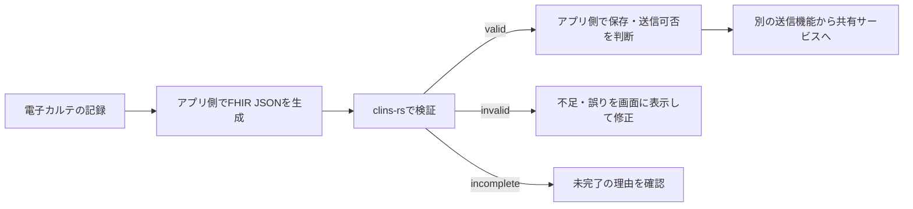

# clins-rs

日本の電子カルテ情報共有向けFHIRデータを、Rustでローカル検証するライブラリです。
**FHIR R4 4.0.1 / JP Core 1.1.2-clins / JP-CLINS 1.13.0** の定義を使い、
生成済みJSONの構造・必須項目・コード・参照・プロファイル制約などを調べます。

[English](README.en.md) · [配布版](https://github.com/genshiai/clins-rs/releases) · [対応範囲](docs/coverage.md) · [今後の予定](docs/roadmap.ja.md)

**2026-11-19 監査で既知の検証不足を確認しました。** 上流R4の146ケースで、
Javaだけが拒否する32件、Rustだけが拒否する6件がありました。
Resource.idの書式・空配列・文書の到達可能性など、現版が違反を見逃して `valid` を返す例があります。
現版の `valid` だけを適合・送信可否の根拠にしないでください。
件数の分母・未完了・条件差と再現手順は [監査レポート](docs/audits/2026-11-19-validation-audit.ja.md) を参照してください。
mainでは [第1段階の修正](docs/audits/2026-11-19-fix-pass-1.ja.md) を実施しています。
検出処理の追加と、専用検査の未実装をincompleteとして明示する変更を区別しています。公開済みalpha.2は未更新です。

## 何に使うものか

電子カルテや連携システムの **FHIR出力後・保存／送信前の検証** に使います。
カルテのデータからFHIR JSONを生成する処理、標準コードの対応付け、人による文書発行、
国のサービスへの認証・送信・結果管理は、利用するアプリケーションが担当します。



病名コードの欠落、必須日付の欠落、参照先の不一致などを、送信前に見つけることが目的です。
診断の正しさや記載内容の医学的妥当性を判断するものではありません。

**現在は実験版alphaです。** `valid` は適用した機械検証で違反・既知の未完了事項が
見つからなかったことを表します。国の受入・認定やCLINS全規則の網羅的な適合を保証しません。
[対応範囲と制限](docs/coverage.md)に、確認済みの範囲を記載しています。

## まず動かす：FHIR JSONを1件検証する

Rust **1.98以上** が必要です。リポジトリをcloneしたディレクトリで実行します。
GitHub ReleasesにはLinux x86_64・macOS arm64のCLIなどもあります。
**crates.io / PyPI / npm / Maven Centralへの登録配布はまだ行っていません。**

```sh
cargo build --locked --release -p clins-cli

# 公開されている規格定義・用語・架空例を取得し、SHA-256を照合する
# 患者データは送信しない
target/release/clins --packages clins-packages.lock.json prepare

# リポジトリ内の架空患者データをCLINSの定義で検証する
target/release/clins --packages clins-packages.lock.json validate crates/core/tests/fixtures/patient.json
```

出力はJSON形式の検証レポートです。`outcome.issue` に問題の内容と対象箇所が入ります。

| status | 意味 | アプリケーションでの扱い |
|---|---|---|
| `valid` | 適用した検証で違反・既知の未完了事項を検出しなかった | 他の業務条件も確認して保存・送信可否を判断する |
| `invalid` | 規則違反が見つかった | エラー箇所を修正して再検証する |
| `incomplete` | 定義・用語・参照先の不足や未対応規則などで判定を完了できない | 適合済みとして扱わず、理由を確認する |

CLI終了コードは **0: valid / 1: invalid / 2: 入力・実行エラー / 3: incomplete** です。
HTTPの200応答だけでは適合を意味しません。必ずレポートの判定を確認してください。

`--packages` を省くと、組み込みの基本R4定義を使います。CLINSの検証には上記の固定パッケージを使ってください。
標準入力、`--profile CANONICAL`、ローカル定義を追加する `--definition path.json` にも対応します。

## アプリケーションへの組み込み

同じRust Coreを、用途に応じた入口から呼びます。Python・TS・Kotlinそれぞれに
別の検証アルゴリズムを実装しているわけではありません。

| 入口 | 使う場面 |
|---|---|
| Rust Core | Rustのアプリ内で直接検証する |
| CLI | ファイルの確認、バッチ、CIで生成データを検査する |
| HTTPサーバー | 電子カルテなどから院内・同一ホストの検証器を呼ぶ |
| Python SDK | Pythonのデータ変換・取込・出力処理に組み込む |
| TypeScript / WASM SDK | ブラウザ、Bun、Nodeのアプリ内で検証する |
| Kotlin / JVM SDK | Kotlin/JVMのアプリからネイティブRustライブラリを呼ぶ |

既存アプリから別のValidatorへ切り替える場合は、APIの形式に加えて、
エンジン識別子・パッケージ版・レポートの判定条件も確認してください。
接続先URLを変更しただけで連携が完了するとは限りません。

### HTTPで呼び出す

```sh
# ターミナル1：規格パッケージ準備後に起動
target/release/clins --packages clins-packages.lock.json serve --bind 127.0.0.1:8091
```

```sh
# ターミナル2：架空患者のFHIR JSONを検証器へ渡す
curl --fail-with-body http://127.0.0.1:8091/validate \
  -H 'Content-Type: application/fhir+json' \
  --data-binary @crates/core/tests/fixtures/patient.json
```

`POST /validate` は独自のレポート、`POST /$validate` と `POST /Patient/$validate` は
FHIRの `OperationOutcome` を返します。標準操作では `resource`・`profile`・`mode=general` を
含む `Parameters` も受け付けます。`GET /health`・`/metadata`・`/capabilities` で状態を確認できます。

既定はloopbackです。HTTPサーバーに認証機能は組み込んでいません。
入力は2 MiBまで、応答には `Cache-Control: no-store` を付けます。
検証中に患者データ内のURLへアクセスすることはありません。

### PythonなどのSDKから呼び出す

SDKでCLINSを検証するために、確認済みの定義を一度JSONへ書き出します。
これは公開された規格定義の束で、患者データではありません。
SDKのパッケージ本体には、この定義ファイルを同梱していません。

```sh
target/release/clins --packages clins-packages.lock.json export-definitions > data/definitions.json
```

Python SDKの[ビルド・導入手順](bindings/python/README.md)に従って導入後、次を実行します。
他のSDKの導入方法は [TS/WASM](bindings/typescript/README.md)・[Kotlin/JVM](bindings/kotlin/README.md) を参照してください。

```python
from pathlib import Path
from clins_py import Validator

validator = Validator(Path("data/definitions.json").read_text())
resource_json = Path("crates/core/tests/fixtures/patient.json").read_text()
report = validator.validate(resource_json)

print(report["status"])
for issue in report["outcome"]["issue"]:
    print(issue.get("severity"), issue.get("expression"), issue.get("diagnostics"))
```

定義を渡さずにSDKを構築すると、基本R4の検証になります。
小数の精度を保持するため、検証対象は **JSON文字列のまま** 渡してください。
実際のアプリでは検証したデータと保存・送信するデータを一致させ、内容が変わったら再検証します。

## 構成と依存関係

```text
clins-core             メモリ内で検証。ネットワーク・ファイル・DBへのアクセスなし
├── clins-packages     規格パッケージの準備・整合性確認
├── clins-server       Axum HTTPアダプター
├── clins-cli          validate / serve / prepare / export-definitions
├── clins-py           Python 3.10以上（PyO3 + maturin）
├── clins-ts           ブラウザ / Bun / Node向けESM + WASM
└── clins-kt           Kotlin/JVM 21（UniFFI + JNA）
```

Heliosのcrate・型・APIには依存しません。内部の構造検証には、Helios 0.2.7のMITコードを
出典・ライセンス表示を保持して取り込んでいます。FHIRPathはOctoFHIR 0.5.10の評価器と
組み込みR4モデルを使用します。Rust・Python・WASM版の実行にJava/JVMやPostgreSQLは不要です。
Kotlin/JVM版は通常どおりJVMとRustのネイティブライブラリを使います。
詳細は[技術選定](docs/architecture.md)と[第三者コードの表示](THIRD_PARTY_NOTICES.md)を参照してください。

## 参照・利用したプロジェクト

| プロジェクト | 役割 | ライセンス・取り込み状況 |
|---|---|---|
| [HL7 FHIR Java Core / Validator](https://github.com/hapifhir/org.hl7.fhir.core) | CLINS公式手順が利用する汎用Java Validator。開発時の動作比較先 | [Apache-2.0](https://github.com/hapifhir/org.hl7.fhir.core/blob/7.0.6/LICENSE.txt)。Javaの実装コードは取り込んでおらず、製品の実行時依存でもない |
| [FHIR/fhir-test-cases](https://github.com/FHIR/fhir-test-cases) | 複数のFHIR実装で共有する試験データ・期待結果。R4 JSONの146ケースを監査に利用 | [Apache-2.0](https://github.com/FHIR/fhir-test-cases/blob/2cfcc672d39fe85dcf358106969cf63e185fd926/LICENSE.txt)。出典・LICENSE・SHA-256を保持。追加設定を要する452ケースは未実行 |
| [Helios / helios-fhir-validator 0.2.7](https://crates.io/crates/helios-fhir-validator/0.2.7) | 内部の構造検証・スキーマ変換などの元となるRust実装 | MIT。改変したソースを取り込み、[元のライセンス](LICENSES/Helios-MIT.txt)と[出典](THIRD_PARTY_NOTICES.md)を保持 |
| [OctoFHIR FHIRPath 0.5.10](https://docs.rs/octofhir-fhirpath/0.5.10/) / [FHIRSchema 0.3.42](https://docs.rs/octofhir-fhirschema/0.3.42/) | RustのFHIRPath評価器・R4型モデル | crateとして利用。固定した依存関係のライセンスは [一覧](THIRD_PARTY_LICENSES.txt) を参照 |
| [JP Core / JP-CLINSと公式Validationガイド](https://jpfhir.jp/fhir/clins/igv1/validationGuide.html) | 日本向けの規格定義・用語・公式の検証手順 | 各提供元の条件に従う。版とSHA-256を [ロックファイル](clins-packages.lock.json) に固定 |

Java Validator 7.0.6との比較は [compare-reference.py](scripts/compare-reference.py) で実行できます。
現在の比較対象は本プロジェクトの架空正常例8件・異常例8件です。
この16件は上流の共有テストを移植したものではありません。
別途 [上流146ケースと追加の到達可能性試験を実行し、既知の不足を確認しています](docs/audits/2026-11-19-validation-audit.ja.md)。
上流試験の再利用・比較条件・判定差分の扱いは [参照Validatorとの比較方針](docs/reference-validation.ja.md) にまとめています。

## 検証・開発予定

`scripts/check.sh` でRustの検査と、固定した公式例・独立した架空例の試験を実行します。
[検証記録](docs/verification.md)にSDK・ブラウザの実行手順があります。
CIはLinux／macOSと各SDKを検証します。配布物の作成は [RELEASING.md](RELEASING.md) を参照してください。

今後は、利用アプリへの組み込み、規則と試験の対応付け、未対応条件の補完、登録配布を進めます。
[スケジュールと完了条件](docs/roadmap.ja.md)では、ライブラリの開発と、医療機関の環境が必要な国サービス接続試験を分けています。

## ライセンス

独自実装は **Apache-2.0**、取り込んだHeliosコードは **MIT** です。
再配布物には両方の表示を保持します（メタデータは `Apache-2.0 AND MIT`）。
FHIR定義・用語パッケージは各提供元の条件に従います。
本プロジェクトは非公式であり、HL7 Japanや電子カルテ情報共有サービスの認定・推奨を意味しません。
